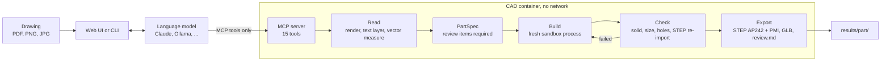

# Drawing2CAD

**Drawing2CAD turns a 2D technical drawing into a checked 3D model as STEP AP242.**

A language model reads the drawing but cannot touch the geometry itself. It builds the part only through 15 structured tools of a local MCP server. That server runs without network access, checks the solid after every step and refuses to export a model it cannot verify. Every assumption the drawing does not state is coloured orange in the model and justified in a review list. An engineer reviews the list instead of a black box.

| Input | Output |
| --- | --- |
| PDF, PNG or JPG drawing (web UI or command line) | STEP AP242 with semantic PMI, GLB for the 3D view, check report `report.json`, review list `review.md` |

## Results

Last full run with Claude Sonnet on 22 drawings (21 sample parts and one changed revision, 18.10.2026). The drawings and reference models are confidential and not part of the repository.

| Metric | Value |
| --- | --- |
| STEP AP242 produced | **21 of 22** |
| Server checks passed | **350 of 351** |
| Open and measure correctly in FreeCAD | **21 of 21** |
| Review items, each with a reason and marked in the model | 39 in 21 parts |
| Bounding box within 0.05 mm of the reference | 20 of 21 |
| Volume within 1 % of the reference | 14 of 21 |
| Full match with the reference (volume, bounding box, hole diameters) | 10 of 21 |
| Duration / cost per part (mean) | about 3 minutes / about 0.49 USD |

"Server checks passed" means the model is consistent with the specification the language model captured. Whether that specification matches the drawing is measured separately against the reference models with `scripts/eval_refs.py`, which the server never sees. Method and per-part results: [docs/ergebnisse.md](docs/ergebnisse.md) (German).

## Quick start

Docker is the only requirement. No language model, no network, no confidential data:

```
docker build -t d2c .
docker run --rm --network none d2c pytest -q            # full test suite
docker run --rm --network none d2c python -m d2c.demo   # ends with "3 of 3 parts exported, all checks passed"
```

The demo builds a bracket, a shaft with chamfer and a flange with an H7 fit, and prints one `PASSED` or `FAILED` line per check. First image build takes 3 to 5 minutes, the tests 15 to 20 minutes, the demo under a minute.

**Web UI with your own drawing** (Docker and [uv](https://docs.astral.sh/uv/), macOS or Linux):

```
./start.sh        # then open http://localhost:8080 and drop a drawing
```

The Claude Code login on the machine is used automatically. Ollama models and any Anthropic-compatible endpoint can be selected too. The run is shown live, then STEP, 3D view and review list are ready under `results/<part>/`.

**View the checked-in sample results without a run:**

```
D2C_RESULTS=examples/demo D2C_DATA=d2c/demo uv run python -m d2c.web
```

**Command line and batch:**

```
D2C_DATA=drawings uv run python -m d2c.agent "Part/Drawing.pdf" --part partname --model sonnet
D2C_DATA=drawings uv run python -m d2c.agent.batch drawings --jobs 3
uv run python -m d2c.agent "Part/Drawing_B.pdf" --part partname --revise   # update an existing model
```

Windows, Docker Compose, all options and environment variables: [docs/reference.md](docs/reference.md).

## How it works



1. **Read.** The model renders the drawing, reads the PDF text layer and measures circles, arcs and contours from the vector geometry. It submits a JSON `PartSpec`: every dimension with its printed text, grid zone, confidence and tolerance, plus features, expected size and holes.
2. **Specify.** The server rejects the specification if an assumed or uncertain dimension has no review item with a reason, or if the title block scale contradicts the measured geometry.
3. **Build.** Structured operations (`extrude`, `revolve`, `add_holes`, `edge_finish`). After every change the server rebuilds the part in a fresh sandbox process and replies with `ok`, `failed` and `next`, so the model corrects its own errors.
4. **Check and export.** Valid closed solid, size, hole diameters and positions, printed dimensions found in the solid, STEP and PMI re-import. Only then `export_step` writes STEP AP242 with PMI, GLB and `review.md`.

| Phase | Tools |
| --- | --- |
| Read | `render_drawing`, `read_drawing_text`, `measure_drawing` |
| Specify | `check_spec`, `submit_spec` |
| Build | `extrude`, `revolve`, `add_holes`, `edge_finish`; `run_script` as sandboxed CadQuery fallback, can be switched off |
| Correct | `edit_op`, `delete_op`, `move_op`, `get_state` |
| Export | `export_step` (optionally `variant="mid"` at the tolerance midpoints) |

Excerpt from a review list (demo bracket):

```
| ID  | Dimension | Issue   | Assumption            | Reason                                                              | Marked faces in STEP |
| rv1 | t10       | missing | Plate thickness 10 mm | Not dimensioned; measured in the front view at scale 1:1           | Faces: 2             |
```

Component diagram with isolation boundaries: 

## Challenge coverage

| Requirement | How Drawing2CAD meets it | Evidence |
| --- | --- | --- |
| MCP server fully local, no cloud | Docker image, server runs with `--network none` | CI runs tests and demo with `--network none` |
| Isolated sandbox, time limit | every build in a separate worker with time, CPU and memory limits; `run_script` sees only an allow list; container read-only, non-root | `d2c/cad/sandbox.py`, `tests/test_sandbox.py` (escape attempts rejected) |
| Open-source CAD kernel on OpenCascade | CadQuery 2.8 on OCP 7.9 | `d2c/cad/ops.py` |
| Few structured tools, free code only as fallback | 15 tools, `run_script` optional; lite mode with small tool sets for small local models | `d2c/server/tools.py` |
| Machine-readable validation after every build | solid, bounding box, holes, printed dimensions, STEP and PMI re-import; JSON report | `d2c/cad/checks.py`, `report.json` per part |
| Independent of the AI model | standard MCP; Claude, Ollama, any Anthropic-compatible endpoint; inputs of small models normalised and reported as `coerced` | `d2c/agent/`, `d2c/server/coerce.py` |
| Flag ambiguity instead of guessing | mandatory review items, scale check, reading and export gates | `d2c/spec.py`, `review.md` |
| Metric: at least 3 parts as STEP | 21 of 22 drawings; demo builds 3 parts without any model | [Results](#results), `python -m d2c.demo` |
| Metric: 100 % valid, opens in CAD | 350 of 351 server checks, 21 of 21 in FreeCAD | `scripts/freecad_check.py` |
| Metric: every assumption in the review list | enforced by `submit_spec`; orange faces in STEP and GLB | `examples/demo/*/review.md` |
| Could: STEP AP242 with semantic PMI | fits, tolerances, toleranced distances, geometric tolerances with datums; read back on every export | `d2c/cad/export.py` |
| Extension: tolerances | ISO 2768-1 and ISO 286-1 read from the drawing, model at tolerance midpoints, compliance per dimension | `d2c/quality/tolerances.py`, `tests/test_tolerances.py` |
| Extension: change a built model | `--revise` keeps the operations, changes only the differences and lists every change | `d2c/quality/revision.py`, `tests/test_revision.py` |

Requirement by requirement with tests and status: [docs/reference.md](docs/reference.md#requirements-matrix).

## Limitations

- **Checks prove consistency, not correctness.** A misread dimension can pass the server checks; printed dimensions that do not occur in the solid are listed in the review list.
- **Reading:** benchmarked on vector PDFs only. Draft angles, countersinks and cavities shown only in sections are sometimes missed. Results vary between runs.
- **Models:** Claude Sonnet is benchmarked. Local models (Ollama) are connected and get lite mode, but only a small sample was tested.
- **Scope:** single solid parts, no assemblies or freeform surfaces. Semantic PMI only, threads as tap drill holes. Not checked in NX or the NIST STEP File Analyzer.
- **Operation:** the web UI has no login and binds to `127.0.0.1`; put a reverse proxy with authentication in front for network access.

## Data flow and privacy

The CAD server and all results stay local. Only page images, text and tool calls go to the selected language model: Anthropic for Claude, your own machine for Ollama. Reference models are read only by the evaluation script. For confidential drawings choose a local model or an organisation API key under your company's terms.

## Project layout

```
d2c/
  spec.py, session.py  data model PartSpec, session with build, review list and export
  drawing/             pages, text layer, scale, vector geometry
  cad/                 CadQuery operations, checks, STEP export, sandbox
  quality/             tolerances, ISO tables, revisions, review list
  server/              MCP server and tools
  agent/               agent on the Claude Agent SDK, batch run
  web/                 web UI
  demo/                demo without language model
tests/                 pytest suite; test_layers.py enforces the layer rule
scripts/               replay, eval_refs, freecad_check, bench_models, check_example
examples/demo/         sample results (STEP, GLB, review list, reports)
docs/                  reference.md, spec.md, ergebnisse.md, architecture
```

CI checks Ruff, the lock file, builds the image on amd64 and arm64, runs tests and demo with `--network none` and compares the sample results.

Third-party components: CadQuery (Apache-2.0), OCP and Open CASCADE (LGPL-2.1 with exception), PyMuPDF (AGPL-3.0), mcp, pydantic and claude-agent-sdk (MIT), model-viewer (Apache-2.0). Details in [NOTICE](NOTICE).
