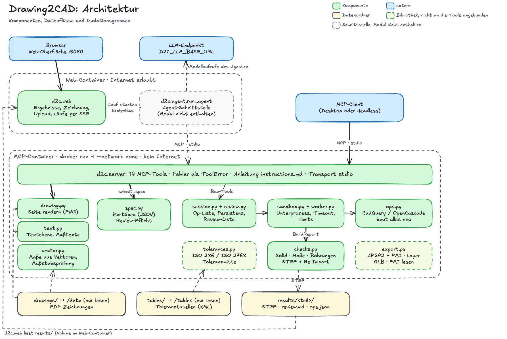

# Drawing2CAD: Systemspezifikation

## 1. Zweck

Drawing2CAD erzeugt aus einer technischen 2D-Zeichnung (Vektor-PDF) ein geprüftes 3D-Volumenmodell im STEP-Format. Ein Sprachmodell liest die Zeichnung und baut das Teil ausschließlich über die Tools eines lokal laufenden MCP-Servers. Der Server prüft nach jedem Bauschritt den Volumenkörper, die Maße und den STEP-Export und meldet das Ergebnis maschinenlesbar zurück. Jede Annahme steht mit Begründung in einer Review-Liste und ist im STEP farbig markiert.

## 2. Geltungsbereich

| Enthalten | Nicht enthalten |
| --- | --- |
| Einzelteile aus genau einem Volumenkörper | Baugruppen |
| Prismatische und rotationssymmetrische Geometrie, Bohrungen mit Senkung und Gewinde-Kernloch, Rundungen, Fasen, Entformungsschrägen | Freiformflächen, Gewindegeometrie |
| Zeichnungen als PDF, Messung aus der Vektorgeometrie | Messung in Rasterbildern und Scans |
| STEP mit farbig markierten Annahmen | Native CAD-Formate |

## 3. Anforderungen

| ID | Anforderung | Umsetzung |
| --- | --- | --- |
| A1 | Konturen, Maße, Bohrungen, Grund-Features und Hinweise einer Zeichnung erkennen | `render_drawing`, `read_drawing_text`, `measure_drawing`; Ergebnis ist die `PartSpec` (5.1) |
| A2 | Mehrdeutige oder fehlende Information markieren statt ungeprüft interpretieren | Review-Pflicht der `PartSpec` (5.1), Review-Liste (9) |
| A3 | Das 3D-Modell entsteht ausschließlich über den MCP-Server und wird als STEP exportiert | Bau-Tools und `export_step` (6) |
| A4 | Der MCP-Server läuft vollständig lokal, ohne Cloud-Abhängigkeit | Docker-Image, Transport stdio, Start mit `--network none` (14) |
| A5 | Modellskripte laufen isoliert: ohne Netzwerk, mit Zeitlimit | Build-Unterprozess mit Timeout und Ressourcengrenzen (14) |
| A6 | Skriptbarer Open-Source-CAD-Kern auf OpenCascade-Basis | CadQuery 2.8.0 mit OCP 7.9.3 |
| A7 | Wenige Tools mit strukturierten Parametern, freier Code nur als Rückfall | 14 Tools, `run_script` als Rückfall (6) |
| A8 | Nach jedem Build prüfen und maschinenlesbar zurückmelden: gültiger Volumenkörper, Maße gegen die Zeichnung, fehlerfreier STEP-Re-Import | `checks.py`, BuildReport (5.3, 7) |
| A9 | Unabhängig vom verwendeten Sprachmodell | MCP-Standard, Arbeitsanleitung `instructions.md` (6) |
| A10 | Unklare Information im 3D-Modell markieren | Orange Flächen, benannt nach dem Review-Eintrag (8.1) |
| A11 | Fehlende Maße aus der Zeichnungsgeometrie annehmen und mit Begründung führen | `measure_drawing`, `assumed` mit `assumption_basis` und Review-Eintrag (5.1) |
| A12 | Toleranzen auslesen, auf Toleranzmitte legen, Einhaltung prüfen | Textebene liest Toleranzen und Passungen; Bibliothek `tolerances.py` (10) |
| A13 | STEP AP242 mit semantischem PMI | Bibliothek `export.py` (8.2) |

## 4. Architektur

### 4.1 Überblick



Quelle der Grafik: `architektur.excalidraw` (Excalidraw).

### 4.2 Ablauf

1. **Zeichnung lesen:** `render_drawing` für jede Seite und für Ausschnitte, `read_drawing_text` für die Textebene, `measure_drawing` für Maße aus der Vektorgeometrie und die Prüfung des Maßstabs.
2. **Beschreibung einreichen:** `submit_spec` prüft die `PartSpec` gegen Schema, Konsistenz- und Review-Regeln und legt das Teil an.
3. **Bauen:** `extrude`, `revolve`, `add_holes` und `edge_finish`, als Rückfall `run_script`. Jede Änderung baut alle Operationen in einem neuen Unterprozess neu und prüft das Ergebnis.
4. **Korrigieren:** `edit_op`, `delete_op` und `move_op` ändern die Liste der Operationen, `get_state` zeigt den Stand.
5. **Exportieren:** `export_step` schreibt STEP, Prüfbericht und Review-Liste, wenn alle Prüfungen bestehen.

### 4.3 Entwurfsentscheidungen

1. **Das Modell ist eine Liste von Operationen.** Jede Änderung baut alle Operationen in einem frischen Prozess neu. Jeder Build ist damit isoliert, aus `ops.json` reproduzierbar und per `edit_op` änderbar.
2. **Explizite globale Koordinaten statt Flächen-Selektoren.** Jede Operation nennt ihre Ebene (`XY`, `XZ`, `YZ` oder `custom`, verschoben entlang der Normalen) und ihre Position. Kleinere Sprachmodelle arbeiten damit zuverlässiger.
3. **Kanten für Rundung und Fase über nahe Punkte** (`near`). Findet die Auswahl keine Kante, ist das ein Fehler, nie stilles Nichtstun.
4. **Review-Pflicht im Schema.** Jedes Maß mit `assumed = true` oder `confidence < 0.8` muss in einem Review-Eintrag stehen, sonst lehnt `submit_spec` die Beschreibung ab.
5. **Markierung im Modell.** Flächen nahe den Punkten `mark_near` eines Review-Eintrags werden im STEP orange gefärbt und nach dem Eintrag benannt.
6. **Isolation in Schichten.** Container ohne Netzwerk, Build in einem Unterprozess mit Zeitlimit und Ressourcengrenzen, für `run_script` zusätzlich eine Prüfung des Syntaxbaums. Die Prüfung liefert verständliche Fehlermeldungen; die Grenze bilden Container und Prozess.
7. **Der Server kennt keine Referenzdaten.** Er liest nur PDF-Zeichnungen unterhalb von `D2C_DATA`.
8. **Server und Sprachmodell sind getrennt.** Der Server braucht kein Netzwerk. Jeder MCP-Client kann ihn nutzen.
9. **Zwei Phasen, ein Vertrag.** In der Lesephase füllt ein Modell mit Bildverständnis die `PartSpec`. In der Bauphase setzt ein beliebiges Modell sie in Operationen um, auch ohne Bildverständnis.
10. **Rückverfolgbarkeit.** Jeder Wert einer Operation, der einem gedruckten Maß entspricht, ist über `refs` an dessen id gebunden. Daraus entsteht die Tabelle „Traceability“ der Review-Liste. Ungebundene Größen stehen in „Values without dimension reference“.
11. **Die Web-Oberfläche hat keinen eigenen Zustand.** Sie zeigt den Ergebnisordner.

### 4.4 Komponenten

| Modul | Aufgabe |
| --- | --- |
| `server.py`, `instructions.md` | MCP-Server mit 14 Tools, Arbeitsanleitung für das Modell |
| `drawing.py` | Pfadprüfung, Seiteninformation, PDF-Seite oder Ausschnitt als PNG |
| `text.py` | Textebene lesen, Maßtexte mit Toleranz, Passung und Symbolen zerlegen |
| `vector.py` | Kreise, Bögen und Ausdehnung aus der Vektorgeometrie, Maßstabsvorschlag, Prüfung von Maßangaben |
| `spec.py` | `PartSpec` mit Konsistenz- und Review-Regeln |
| `ops.py` | Operationsmodelle und Aufbau des Körpers mit CadQuery |
| `session.py` | Teile, Operationslisten und Persistenz unter `results/` |
| `sandbox.py`, `worker.py` | Build im Unterprozess mit Zeitlimit und Ressourcengrenzen, Prüfung von Skripten |
| `checks.py` | Volumenkörper, Maße und Bohrungen, STEP-Export mit Farben und Re-Import |
| `review.py` | Review-Liste als Markdown und JSON |
| `export.py` | Bibliothek: STEP AP242 mit semantischem PMI, GLB, PMI-Leser |
| `tolerances.py` | Bibliothek: ISO 286, ISO 2768, Toleranzmitte, Einhaltung |
| `web/` | Ergebnisansicht im Browser, Upload, Läufe per Server-Sent Events |

### 4.5 Technologie

Python 3.12, `cadquery==2.8.0` (OCP 7.9.3), `mcp==2.3.0`, pydantic 2, `pymupdf==1.28.2` (Lizenz AGPL), poppler-utils, pytest. Docker-Basis `python:3.12-slim` mit den Paketen `libgl1`, `libglu1-mesa`, `libxrender1` und `poppler-utils`.

## 5. Datenmodell

### 5.1 PartSpec

Die `PartSpec` beschreibt ein Teil so, wie es auf der Zeichnung steht, bevor Geometrie entsteht.

```
PartSpec
  name: str                  Muster [\w-]+, wird Ordnername unter results/
  drawing: str               Pfad relativ zu D2C_DATA, z. B. "Teil/Teil.pdf"
  page: int = 1
  title: str
  scale: str                 wie im Schriftfeld, z. B. "2:1"
  units: "mm"
  general_tolerance: str | null     "ISO 2768-f", "-m", "-c" oder "-v"
  views: [View]
  dimensions: [Dimension]
  features: [Feature]
  notes: [Note] = []
  expected: Expected
  review: [ReviewItem]

View          id, kind (front, top, side, section, detail, iso), scale, note = ""
Dimension     id, kind (length, diameter, radius, angle, chamfer, thread, count),
              value (mm, Winkel in Grad), text (wie gedruckt), source: Source | null,
              confidence (0 bis 1), assumed = false, assumption_basis: str | null,
              tol_upper, tol_lower: float | null, fit: str | null (z. B. "H7")
Source        view, cell: str | null (Rasterfeld A1 bis F8, null ohne Raster)
Feature       id, type (base, boss, pocket, hole, slot, fillet, chamfer, thread, revolve, other),
              dim_ids, note = ""
Note          id, text, source: Source | null
Expected      bbox: (x, y, z) Ausdehnung in Modellkoordinaten, holes: [ExpectedHole] = []
ExpectedHole  d, at: (x, y, z) Punkt auf der Achse, axis: (x, y, z), dim_ids
ReviewItem    id, refs, issue (missing, ambiguous, low_confidence, conflict, convention),
              assumption, reason, mark_near: [(x, y, z)] = []
```

Regeln, geprüft beim Einreichen:

- Unbekannte Felder sowie NaN und Unendlich werden abgelehnt.
- Alle ids sind eindeutig über Ansichten, Maße, Features, Hinweise und Review-Einträge.
- Verweise müssen existieren: `refs` auf Maße, Features oder Hinweise; `dim_ids` auf Maße; `source.view` auf Ansichten.
- **Review-Pflicht:** Jedes Maß mit `assumed = true` oder `confidence < 0.8` steht in den `refs` mindestens eines Review-Eintrags.
- Ein angenommenes Maß braucht eine nicht leere `assumption_basis`, jeder Review-Eintrag eine nicht leere `assumption` und `reason`.
- Bei nicht angenommenen Maßen enthält `text` eine Zahl gleich `value`. Das Komma gilt als Dezimaltrenner: „76,2“ ergibt 76,2, nie 762.
- `tol_upper` und `tol_lower` werden nur gemeinsam angegeben, `tol_lower` liegt nicht über `tol_upper`.
- Ein Feature vom Typ `hole` verlangt mindestens einen Eintrag in `expected.holes`. Eine Achse darf nicht der Nullvektor sein.
- Alle Verstöße kommen gesammelt in einer Fehlermeldung zurück.

### 5.2 Operationen

| `op` | Felder | Wirkung |
| --- | --- | --- |
| `extrude` | `profile`, `plane`, `distance` (nicht 0), `mode`, `both`, `taper` | Profil aus der Ebene extrudieren; `both` symmetrisch zur Ebene; `taper` als Entformungsschräge in Grad |
| `revolve` | `points` (r, z) oder `profile` (path), `angle` (bis 360 Grad), `mode` | Profil in der XZ-Ebene um die globale Z-Achse drehen |
| `holes` | `plane`, `d`, `positions` oder `polar`, `depth`, `kind`, `cbore_d`, `cbore_depth`, `csk_d`, `csk_angle`, `thread`, `thread_core`, `flip` | Bohrungen abtragen |
| `edge_finish` | `kind` (fillet, chamfer), `size`, `near`, `tol` (Standard 0,5 mm) | Rundung oder Fase an allen Kanten nahe den Punkten |
| `script` | `code` | Rückfall: CadQuery-Code ersetzt den Körper durch `result` |

- **Verknüpfung:** `extrude` und `revolve` haben `mode`: `add` vereinigt, `cut` zieht ab, `intersect` schneidet mit dem bisherigen Körper. Die erste Operation muss Material aufbauen (`add` oder `script`). `holes` trägt immer ab, `edge_finish` ändert den bestehenden Körper.
- **Profile:** `rect` {center, w, h, corner_radius}, `circle` {center, d}, `slot` {center, center_distance, width, angle}, `path` {start, segments aus `line`, `arc3` und `radius_arc`, fillets mit `at` und `r`}, `hull` {circles aus (u, v, r)}. `hull` erzeugt die exakte Kontur aus Kreisbögen und äußeren Tangenten.
- **Ebenen:** `XY` mit Normale +Z (u = X, v = Y), `XZ` mit Normale −Y (u = X, v = Z), `YZ` mit Normale +X (u = Y, v = Z), `custom` mit `origin`, `normal` und `xdir`. `offset` verschiebt entlang der Normalen. Profil- und Bohrungskoordinaten (u, v) gelten in der Ebene, `near` und Skripte global. Einheiten mm und Grad, Z nach oben.
- **Bohrungen:** Sie beginnen in der Ebene und laufen gegen die Normale, `flip` kehrt die Richtung um. Ohne `depth` gehen sie durch das ganze Teil. `positions` listet die Mittelpunkte, `polar` {center, pitch_d, count, start_angle} verteilt sie auf einem Lochkreis. `cbore` ergänzt eine Flachsenkung (`cbore_d`, `cbore_depth`), `csk` eine Kegelsenkung (`csk_d`, Spitzenwinkel `csk_angle`, Standard 90 Grad).
- **Gewinde:** `kind = tapped` mit `thread` wie „M5“ oder „M10x1“ und `d` gleich dem Nenndurchmesser. Modelliert wird die Kernlochbohrung ohne Gewindegeometrie: mit `thread_core = tap_drill` nach Tabelle (M2 1,6 · M2,5 2,05 · M3 2,5 · M4 3,3 · M5 4,2 · M6 5,0 · M8 6,8 · M10 8,5 · M12 10,2, sonst Nenndurchmesser minus Steigung), mit `minor` als d − 1,082532 · P. Regelsteigungen sind für M2, M2,5, M3, M4, M5, M6, M8, M10, M12, M16 und M20 hinterlegt; für andere Größen gehört die Steigung in die Angabe, z. B. „M14x2“.
- **Kantenauswahl:** Gewählt wird jede Kante außer Nahtkanten, die höchstens `tol` von einem der Punkte `near` entfernt ist. Ohne Treffer meldet die Operation einen Fehler.
- **Rückverfolgbarkeit:** Jede Operation trägt `refs: {"<Parameterpfad>": "<Maß-id>"}`, z. B. `{"profile.d": "d1"}`. Der Pfad muss auf eine Zahl der Operation zeigen, die id muss in der `PartSpec` stehen.
- **Prüfungen beim Aufbau:** Eine Entformungsschräge, die das Profil vor der vollen Länge zusammenfallen lässt, ist ein Fehler. Ein Rotationsprofil darf die Achse nicht überschreiten. Eine Rundung im Profil braucht genau eine Ecke im Umkreis von 0,5 mm um `at`. Entfernt ein abtragender Schritt kein Material, meldet der Build eine Warnung.

### 5.3 BuildReport

Jedes Bau-Tool gibt diesen Bericht zurück:

```
{ "ok": bool, "error": str | null,
  "solid": {"valid", "solids", "free_edges", "volume", "bbox": [xmin, ymin, zmin, xmax, ymax, zmax], "ok"},
  "dims": [{"check": "bbox_x" | "bbox_y" | "bbox_z" | "hole", "expected", "actual", "ok", "dim_ids"}],
  "build_notes": [{"op_index", ...}],
  "roundtrip": {"path", "reimport_valid", "solids", "volume_rel_diff", "marks": [{"id", "faces"}], "ok"},
  "op_index": int }
```

- `ok` ist wahr, wenn `solid.ok`, alle `dims` und `roundtrip.ok` wahr sind.
- Bei `error` (ungültige Operation, Fehler im Aufbau, Zeitüberschreitung) bleibt die bisherige Operationsliste unverändert. Ein Build mit `ok = false` ohne `error` wird übernommen, denn während des Aufbaus fehlen Features noch.
- `op_index` ist der Index der neuen oder geänderten Operation. Der Bericht von `export_step` hat kein `op_index`.
- `build_notes` enthalten je Operation Zusatzangaben, z. B. `drilled_d`, `edges_selected`, `hull_circles` oder `warning`.

## 6. MCP-Schnittstelle

Der Server heißt `drawing2cad`, spricht MCP über stdio und liefert `instructions.md` als Arbeitsanleitung an den Client. Er bietet 14 Tools, keine Ressourcen und keine Prompts.

### 6.1 Tools

| Tool | Parameter | Ergebnis |
| --- | --- | --- |
| `render_drawing` | `pdf`, `page` = 1, `dpi` = 100, `crop` | PNG der Seite oder des Ausschnitts und Seiteninformation |
| `read_drawing_text` | `pdf`, `page` = 1, `region` | Textelemente mit Position, Schrift und zerlegtem Maß, höchstens 300 je Aufruf |
| `measure_drawing` | `pdf`, `page` = 1, `region`, `scale`, `printed_dims`, `expect`, `edge_width` = "auto" | Ausdehnung, je höchstens 12 Kreise und Bögen in mm, Maßstabsvorschlag, Prüfung von Angaben wie `d=30` oder `L=80`, Hinweise |
| `submit_spec` | `spec` | Teil anlegen oder neu beginnen |
| `extrude`, `revolve`, `add_holes`, `edge_finish` | `part` und die Felder der Operation | BuildReport |
| `run_script` | `part`, `code` | BuildReport |
| `edit_op` | `part`, `index`, `op` | BuildReport |
| `delete_op` | `part`, `index` | BuildReport |
| `move_op` | `part`, `index`, `new_index` | BuildReport |
| `get_state` | `part` | Kurzfassung der Spec, Operationen, letzter Bericht |
| `export_step` | `part` | Bei Erfolg Dateien und Bericht, sonst `ok = false` mit Bericht |

- `crop` und `region` sind Bruchteile der angezeigten Seite (x0, y0, x1, y1), Ursprung oben links.
- `render_drawing` begrenzt die Auflösung auf 600 dpi und die längere Bildseite auf 2000 Pixel.
- `measure_drawing` misst in Millimetern im Maßstab `scale` (ohne Angabe 1:1). Jede Angabe in `expect` erhält den Status `ok` (höchstens 0,05 mm Abweichung), `MISMATCH` oder `no_candidates`. Aus `printed_dims` (empfohlen sind mindestens sechs) schlägt es einen Maßstab vor und meldet, wenn der Maßstab des Schriftfelds nicht zur Geometrie passt.
- `edge_width` legt fest, welche Strichstärke als sichtbare Kante zählt: `auto` erkennt sie, `all` nimmt alle, eine Zahl wählt die nächstliegende Strichstärke in pt.
- `submit_spec` für ein vorhandenes Teil beginnt neu: Die Operationsliste wird geleert.
- Ungültige Parameter, unbekannte Teile und Indizes außerhalb der Liste gehen als `ToolError` mit verständlicher Meldung an den Client, andere Ausnahmen nur als allgemeiner Fehler des Tools. Fehler im Aufbau stehen im Feld `error` des Berichts.

### 6.2 Zeichnungsanalyse

- **Rendern** (`drawing.py`): poppler `pdftoppm` rendert die angezeigte Seite, also die CropBox mit der Seitendrehung. Seiten zählen ab 1.
- **Textebene** (`text.py`): poppler `pdftohtml -xml` liefert Textstücke, die zu Zeilen zusammengesetzt werden. Zeichen der Symbolschriften `ISO1Symbols` und `GDTSymbols` haben keine Unicode-Zuordnung und werden zurückübersetzt: Ø, ±, ⊥, ⌖, ∥, ▱, ◎, ⌯, ↗ und Ⓔ (Hüllbedingung). Jedes Maß wird zerlegt in `prefix` (Ø, R, M), `count` (z. B. 4x), `nominal`, `tol_upper`, `tol_lower`, `fit`, `envelope` und `thread`. Eine gestapelte Toleranz bleibt ein eigenes Element neben ihrem Maß. Rahmen von Form- und Lagetoleranzen werden nicht zerlegt. Schräger Text kann zerstückelt sein und wird im Bild geprüft. Ist der Text einer Zeichnung in Linien umgewandelt, liefert die Textebene keine Elemente.
- **Vektormessung** (`vector.py`, PyMuPDF): Kreise und Bögen entstehen aus Bézierkurven und Polylinien der sichtbaren Kanten. Die Ausdehnung ist das Hüllrechteck der größten geschlossenen Kontur, ohne Kontur das aller sichtbaren Elemente. Ergebnisse stehen in Modell-mm (Blatt-mm geteilt durch den Maßstab), x nach rechts, y nach oben, Ursprung unten links im Bereich. Der Maßstabsvorschlag vergleicht gemessene mit gedruckten Maßen und liefert bis zu fünf Verhältnisse, geordnet nach der Zahl der Übereinstimmungen, jeweils mit dem passenden Normmaßstab (1:20 bis 20:1, Abweichung unter 0,5 %), falls es einen gibt.

## 7. Prüfungen und Abnahmeschwellen

| Prüfung | Schwelle |
| --- | --- |
| Volumenkörper | `isValid()`, genau ein Solid, keine freien Kanten, Volumen größer 0 |
| Gesamtmaße | Achsparallele Ausdehnung je Achse in Modellkoordinaten höchstens 0,01 mm Abweichung von `expected.bbox` |
| Bohrungen | Eine konkave Zylinderfläche je erwarteter Bohrung: Durchmesser höchstens 0,01 mm Abweichung, Abstand der Achse zu `at` höchstens 0,01 mm, Achsen parallel (Betrag des Kosinus mindestens 0,9999) |
| STEP-Roundtrip | Re-Import gültig, genau ein Solid, relative Volumenänderung höchstens 1e-6, jede Markierung trifft mindestens eine Fläche |

Die Prüfungen laufen nach jedem Build, nicht nur beim Export. Tiefe und Durchgang einer Bohrung sowie zusätzliche, nicht erwartete Bohrungen werden nicht geprüft.

## 8. Export

### 8.1 STEP aus `export_step`

Der Build-Prozess schreibt `<teil>.step` über eine CadQuery-Baugruppe, Schema AP214 (`AUTOMOTIVE_DESIGN`), Einheit mm:

| Bedeutung | Farbe (RGB) |
| --- | --- |
| Körper | 0,6 / 0,67 / 0,69 |
| Fläche eines Review-Eintrags, benannt mit dessen id | 1,0 / 0,5 / 0,0 (orange) |

Eine Fläche gehört zu einem Review-Eintrag, wenn sie höchstens 0,5 mm von einem seiner Punkte `mark_near` entfernt ist. Bestehen nicht alle Prüfungen, löscht `export_step` STEP, Bericht und Review-Liste des Teils und meldet `ok = false`.

### 8.2 Bibliothek `export.py`

`export.py` ist getestet, wird aber von den MCP-Tools nicht aufgerufen. Es stellt bereit:

- **STEP AP242** (`AP242_MANAGED_MODEL_BASED_3D_ENGINEERING_MIM_LF`) über den XCAF-Writer von OpenCascade, mit Farben, Namen, Layern und semantischem PMI.
- **Semantisches PMI:** Bohrungsdurchmesser als `DIMENSIONAL_SIZE` mit Passung (`LIMITS_AND_FITS`) oder Plus-Minus-Toleranz. Ein angenommenes, fehlendes Längenmaß zwischen zwei parallelen Ebenen als `DIMENSIONAL_LOCATION` mit der Beschreibung „ASSUMED: <Annahme> - <Grund> - please check“.
- **Markierung:** Review-Flächen orange, benannt „CHECK <id>“, auf dem Layer `ASSUMED_CHECK`. Gewindebohrungen grün (0,396 / 0,941 / 0,451). Namen und Beschreibungen werden in ASCII umgesetzt („Ø“ wird „dia“).
- **GLB** für Web-Ansichten, mit denselben Farben, dazu `marks.json` (Farbe zu Review-ids). PMI und Layer gehen im GLB verloren.
- **PMI-Leser** `read_pmi`: Schema, Maße mit Toleranz und Passung, Farben und Layer einer STEP-Datei.

## 9. Review-Liste und Rückverfolgbarkeit

`export_step` schreibt die Review-Liste als `review.md` (Markdown, Englisch) und `review.json`. `review.md` beginnt mit Titel, Teil, Zeichnung, Maßstab und Allgemeintoleranz und endet mit der Zeile `All checks passed: yes` oder `no`. Dazwischen stehen diese Abschnitte:

| Abschnitt | Inhalt |
| --- | --- |
| Assumptions and open issues | Je Review-Eintrag: Maße, Problem, Annahme, Grund, Quelle auf der Zeichnung, Zahl der markierten Flächen |
| Drawing notes | Hinweise der Zeichnung |
| Traceability | Je Eintrag in `refs`: Operation, Parameter, aktueller Wert, Maß-id, gedruckter Text |
| Values without dimension reference | Größen einer Operation ohne `refs` und ohne gleich großes Maß (Abstand höchstens 0,01 mm): abgeleitete oder geschätzte Werte |
| Validation | Alle Prüfungen mit Soll, Ist und Ergebnis |

`review.json` enthält dieselben Daten unter `assumptions`, `notes`, `traceability`, `unreferenced`, `validation` und `all_ok`.

## 10. Toleranzen (Bibliothek `tolerances.py`)

`tolerances.py` ist getestet, wird aber von den MCP-Tools nicht aufgerufen.

- **Grenzabmaße** eines Maßes, in dieser Reihenfolge: die gedruckten (`tol_upper` und `tol_lower`), die Passung nach ISO 286 (`fit`), die Allgemeintoleranz nach ISO 2768 (`general_tolerance`, nur für Längen, Durchmesser und Radien). Ohne Angabe sind beide Abmaße 0.
- **Tabellen:** XML-Dateien im Ordner `D2C_TABLES`, `*isolim*.xml` für ISO 286 und `*toltabs*.xml` für ISO 2768. Liegt ein Maß außerhalb der Tabelle oder fehlt eine Klasse, meldet das Modul einen Fehler; es extrapoliert nicht.
- **Toleranzmitte:** Nennmaß plus Mittelwert der beiden Grenzabmaße, auf 6 Nachkommastellen gerundet. `apply_mode(ops, spec, "mid")` setzt jeden über `refs` gebundenen Wert auf die Toleranzmitte seines Maßes.
- **Einhaltung:** `compliance` prüft für jedes tolerierte Maß die gebundenen Werte der Operationen und bei Durchmessern die gemessenen Bohrungen gegen die Grenzen (Spielraum 1e-6 mm). Ein Maß ohne Werte gilt als eingehalten.

## 11. Ergebnisablage

```
results/<teil>/
  spec.json, ops.json        nach submit_spec und nach jedem übernommenen Build
  <teil>.step                nach erfolgreichem export_step: Modell
  report.json                nach erfolgreichem export_step: Prüfbericht
  review.md, review.json     nach erfolgreichem export_step: Review-Liste
```

## 12. Web-Oberfläche

`python -m d2c.web [--host H] [--port P]` startet die Ansicht (Standard 0.0.0.0:8080).

| Methode und Pfad | Zweck |
| --- | --- |
| `GET /` | Oberfläche (`static/index.html`) |
| `GET /api/parts` | Alle Teile: Name, Titel, `all_ok`, Zahl der Review-Einträge, Dateien, Zeile des Teils aus `results/EVAL.json`, falls vorhanden |
| `GET /api/parts/{name}` | Ein Teil wie oben, dazu Spec, Review-Liste und Bericht |
| `GET /api/parts/{name}/drawing.png` | Erste Seite der Zeichnung des Teils, 100 dpi |
| `GET /files/{name}/{file}` | Datei aus dem Ergebnisordner des Teils |
| `POST /api/runs` | Zeichnung hochladen und Lauf starten |
| `GET /api/runs/{run_id}/events` | Ereignisse eines Laufs als Server-Sent Events |

- **Upload:** Formularfelder `pdf`, `part` und optional `model` (sonst `D2C_LLM_MODEL`). Angenommen werden nur PDF-Dateien (Signatur `%PDF`). Die Datei wird unter `<D2C_DATA>/uploads/<part>.pdf` gespeichert, die Antwort ist `{"run_id": ...}`. Ohne `D2C_LLM_BASE_URL` antwortet der Endpunkt mit 503, bei fehlender Datei, ungültigem Teilnamen, anderem Dateityp oder fehlendem Modell mit 400.
- **Ereignisse:** Je Ereignis eine Zeile `data: <JSON>`. Das letzte Ereignis hat den Typ `done`: vom Agenten selbst, sonst aus seinem Rückgabewert, bei einer Ausnahme mit `ok = false` und `reason`. Danach endet der Strom. Läufe und Ereignisse liegen im Speicher des Prozesses; jede Verbindung erhält alle Ereignisse ab dem ersten.
- **Agent-Schnittstelle:** Ein Lauf ruft `d2c.agent.run_agent(pdf, part, model, base_url, api_key, build_model, server, on_event)` als Coroutine auf. `on_event` erhält jedes Ereignis als Objekt. Das Modul `d2c.agent` ist nicht Teil dieses Repositorys.
- **Dateinamen** in Pfaden dürfen weder `/`, `\`, `..` noch NUL enthalten.
- **Statische Dateien** unter `/static/`: `index.html`, `style.css` und `vendor/model-viewer.min.js` (Lizenz in `vendor/model-viewer.LICENSE`). Das in `index.html` eingebundene Skript `static/app.js` ist nicht enthalten.

## 13. Konfiguration

### 13.1 Umgebungsvariablen

| Variable | Standard | Zweck |
| --- | --- | --- |
| `D2C_DATA` | `/data` | Ordner der Zeichnungen |
| `D2C_RESULTS` | `/app/results` | Ergebnisordner |
| `D2C_TABLES` | `/tables` | Toleranztabellen (nur `tolerances.py`) |
| `D2C_TIMEOUT` | `60` | Zeitlimit eines Builds in Sekunden |
| `D2C_LLM_BASE_URL`, `D2C_LLM_API_KEY`, `D2C_LLM_MODEL`, `D2C_LLM_BUILD_MODEL` | leer | Einstellungen für Läufe aus der Web-Oberfläche |
| `D2C_MCP_URL` | `stdio` | Verbindung des Laufs zum MCP-Server |

Alle Variablen werden bei jedem Aufruf neu gelesen.

### 13.2 Datenordner

Die Ordner liegen außerhalb des Images und werden beim Start eingehängt.

| Ordner im Repo | Im Container | Inhalt |
| --- | --- | --- |
| `drawings/` | `/data` | PDF-Zeichnungen, Unterordner `uploads/` für hochgeladene Zeichnungen |
| `results/` | `/app/results` | Ergebnisse |
| `tables/` | `/tables` | Toleranztabellen für `tolerances.py` |

## 14. Sicherheit und Isolation

- **Netzwerk:** Der Server kommuniziert nur über stdio. Mit `docker run --network none` hat er keinen Netzwerkzugang.
- **Build-Prozess:** Jeder Build läuft in einem eigenen Prozess `python -I -m d2c.worker` in einer eigenen Prozessgruppe, mit temporärem Arbeitsordner und nur der Umgebungsvariablen `PATH`. Grenzen: Zeitlimit `D2C_TIMEOUT`, danach wird die Prozessgruppe beendet; Adressraum 4 GiB; Dateigröße 200 MiB; CPU-Zeit 4 · ⌈Zeitlimit⌉ + 10 s.
- **Skripte:** `run_script` lehnt Importe, die Namen `open`, `exec`, `eval`, `compile`, `__import__`, `globals`, `locals`, `vars`, `getattr`, `setattr`, `delattr`, `input` und `breakpoint` sowie Namen und Attribute mit führendem Unterstrich ab. Das Skript sieht nur `cq`, `math`, `result` und 15 einfache Builtins.
- **Pfade:** Zeichnungen nur als `.pdf` unterhalb von `D2C_DATA`, aufgelöst über ihr tatsächliches Ziel. Teilnamen nur aus Buchstaben, Ziffern, `_` und `-`.
- **Web-Oberfläche:** Sie hat keine Anmeldung und lauscht standardmäßig auf allen Schnittstellen (0.0.0.0).
- **Geheimnisse:** Zugangsdaten nur über Umgebungsvariablen, nie im Repository.

## 15. Betrieb

```
# Image bauen und Tests ausführen
docker build -t d2c .
docker run --rm d2c pytest -q

# MCP-Server über stdio, ohne Netzwerk
docker run -i --rm --network none -v "$PWD/drawings":/data:ro -v "$PWD/results":/app/results d2c

# Web-Oberfläche auf Port 8080
docker run --rm -p 8080:8080 -v "$PWD/results":/app/results -v "$PWD/drawings":/data d2c python -m d2c.web
```

Tests mit dem Marker `bct` brauchen Beispieldaten unter `/app/data` und werden sonst übersprungen.

## 16. Grenzen

- Maße werden nur aus Vektorgeometrie gemessen. Bei gescannten Zeichnungen liest das Modell die Maße aus dem gerenderten Bild.
- Gewinde werden als Kernlochbohrung modelliert, Form- und Lagetoleranzen nicht als semantisches PMI.
- `export.py` und `tolerances.py` sind nicht an die MCP-Tools angebunden. Das STEP aus `export_step` ist AP214 mit Farben und benannten Flächen, ohne semantisches PMI und ohne GLB.
- Das Modul `d2c.agent` ist nicht enthalten. Läufe aus der Web-Oberfläche brauchen es.
- Die Browser-Oberfläche ist ein Gerüst: Das Skript `static/app.js` fehlt. Nutzbar ist die JSON-API.
- Der Server verwaltet alle Teile in einer Sitzung ohne Sperren. Gleichzeitige Aufrufe für dasselbe Teil sind nicht vorgesehen.
