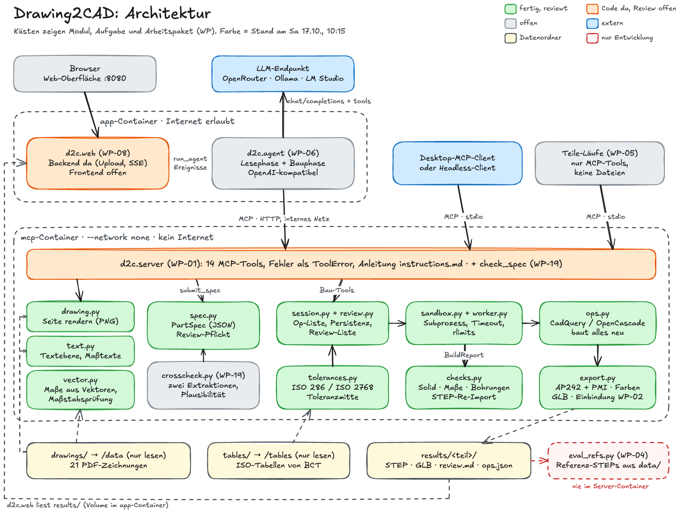

# Drawing2CAD: Spec für das Team

Team MSN (Kristian Kalfic, Eren Gözgen, Atakan Taskan, Abu Abdi). Challenge „Drawing2CAD“ von BCT Technology AG, Black Forest Hackathon 2026. Repo: https://github.com/KristianKalfic/DRAWING2CADMSN

Wer ein Arbeitspaket übernimmt, liest Abschnitt 1, 4 und 5 und hält sich an die Schnittstellen in Abschnitt 5. Einrichten und Arbeitsregeln: `README.md` Abschnitt 7. Eine Schnittstelle ändert nur, wer es vorher im Team ansagt und diese Datei im selben PR anpasst.

---

## 1. Ziel und Bewertung

**Ziel (Challenge-Seite):** Ein KI-Prototyp analysiert technische 2D-Zeichnungen, erkennt Konturen, Maße, Bohrungen und Grund-Features und erzeugt daraus ein einfaches 3D-Modell. Unklare Information wird zur Prüfung markiert statt ungeprüft interpretiert. Die KI baut das Modell nicht selbst, sondern über einen lokal laufenden MCP-Server, den wir bauen.

| Anteil | Wer | Was zählt |
| --- | --- | --- |
| 50 % | KI-Prüfer | Code, Architektur, Baubarkeit. Der Prüfer baut das Repo nach README. Ein fehlgeschlagener Build senkt den Score, disqualifiziert aber nicht. |
| 50 % | Jury | Live-Pitch, etwa 5 Minuten, So ab 13:00 (zwei Runden, rund 15 Teams). Das Deck (PDF) liest die Jury vorab. |

**Abgabe:** So 18.10.2026, **11:30**, genau eine finale Abgabe: Repo-URL, Branch, optional Tag, 40-stellige Commit-SHA, README-Text. Jedes Teammitglied kann die Abgabe ersetzen.

**Team-Key:** OpenRouter, 13,33 $ Budget, endet mit der Veranstaltung. Nur in `.env` (steht in `.gitignore`), nie committen, nie in Chat oder Doku.

**BCT vor Ort** laut Challenge-Seite: Fr 16.10. 16:00–19:00 (dazu 08:00–19:00 remote) und **Sa 17.10. 08:00–15:15**. Für Sonntag ist keine BCT-Zeit eingetragen. Alles, was BCT prüfen oder freigeben soll (NX-Check, Zusatzdaten, Veröffentlichung), muss bis Sa 15:15 passieren (WP-16).

**Mentoren der Challenge:** Jannik Schüle (Vision Language Models, Tool Calling/MCP, KI-Architektur), Jan Müllerleile (CAD, NX, Beispieldaten), Adin Özder, Sascha Ellmer, Marko Weber. Kontaktdaten stehen auf Folie 2 und 3 der Challenge-Folien.

---

## 2. Anforderungen

Quelle: Challenge-Seite (Abschnitte Goal, Technical Approach, Metrik, must, could) und Challenge-Folien (Milestones, Extension). Jede Anforderung bekommt im README eine Zeile der Anforderungsmatrix: Anforderung → Modul → Test → Beleg.

### 2.1 Muss (must und Metrik)

| ID | Anforderung | Quelle |
| --- | --- | --- |
| R1 | Konturen, Maße, Bohrungen und Grund-Features erkennen, dazu Hinweise (Notes). Eingabe laut Challenge: PDF, Scan oder Bild | must, Beschreibung, Folie Milestones 2 |
| R2 | Mehrdeutige oder unklare Information markieren statt ungeprüft interpretieren | must, Goal |
| R3 | Das 3D-Modell entsteht **ausschließlich** über den MCP-Server und wird als STEP exportiert | must |
| R4 | Der MCP-Server läuft vollständig lokal (z. B. Docker), ohne Cloud-Abhängigkeit | Technical Approach |
| R5 | Modellskripte laufen in einer isolierten Sandbox: kein Netzwerk, Zeitlimit pro Lauf | Technical Approach |
| R6 | Skriptbarer Open-Source-CAD-Kern auf OpenCascade-Basis: **CadQuery** (Teamentscheidung) | Technical Approach |
| R7 | Wenige, klar beschriebene Tools mit strukturierten Parametern. Freier Code nur als Rückfall für Geometrie, die die Tools nicht abdecken, damit auch kleinere, lokal laufende Modelle den Server zuverlässig nutzen | Technical Approach |
| R8 | Nach jedem Build prüfen und das Ergebnis maschinenlesbar zurückgeben, damit die KI eigene Fehler korrigiert: (a) Solid geschlossen und gültig, (b) Modellmaße gegen Zeichnungsmaße (Gesamtgröße, Bohrungs-Ø, Bohrungspositionen), (c) exportiertes STEP fehlerfrei re-importieren | Technical Approach |
| R9 | Unabhängig vom verwendeten KI-Modell | Technical Approach |
| R10 | Unklare Information im 3D-Modell markieren, „mit PMIs oder Farben“ | Folie Milestones 4 |
| R11 | Zeichnung hochladen, die Analyse startet automatisch | Folie Milestones 1 |
| R12 | Vorführung mit echten Beispieldaten | Folie Milestones 5 |
| M1 | Mindestens 3 Beispielteile als STEP | Metrik |
| M2 | 100 % der exportierten STEP-Dateien bestehen die Prüfungen des Servers und öffnen fehlerfrei in einem CAD-System wie NX. Beleg: NX-Sichtung durch BCT (WP-16), FreeCAD-Gegenprüfung aller Teile (WP-19) | Metrik |
| M3 | Jedes in der Zeichnung fehlende Maß wird aus der Zeichnungsgeometrie angenommen und mit Begründung in einer Review-Liste geführt | Metrik |

Empfohlener Ablauf laut Challenge: Zeichnung → strukturierte Zwischenbeschreibung in JSON (Features, Maße, gefundener Wert, Konfidenz, Review-Flags) → MCP-Server baut → Validierung → Export. Genau das ist unsere `PartSpec` (Abschnitt 5.1).

Folien-Meilensteine: 1 → R11, 2 → R1, 3 („solid body 3D model“) → R3 und R8, 4 → R10, 5 → R12.

**Eingabeformate (R1):** Alle BCT-Zeichnungen sind Vektor-PDFs, darauf ist der Kern ausgelegt. Scans und Bilder laufen über den Bildpfad: rendern, das Vision-Modell liest die Maße, fehlende Maße werden über Verhältnisse in der Zeichnung angenommen und gehen in die Review-Liste. Die Vektormessung entfällt dort, `measure_drawing` sagt das in `notes` (WP-01). Die Web-Oberfläche nimmt PNG und JPG an und wandelt sie mit PyMuPDF in ein einseitiges PDF um (WP-08). README und Pitch nennen die Grenze ehrlich: gemessen nur an Vektor-PDFs.

### 2.2 Kann (could) und Erweiterung

| ID | Anforderung | Quelle |
| --- | --- | --- |
| C1 | STEP AP242 mit semantischem PMI | could |
| C2 | Validierungsschritt für das PMI, z. B. NIST STEP File Analyzer and Viewer | could |
| X1 | Toleranzen auslesen, asymmetrische Toleranzen auf Toleranzmitte legen, prüfen, ob das 3D-Modell alle Maße und Toleranzen erfüllt; bestehende Modelle ändern | Goal, Folie Extension  |

### 2.3 Abgabe und Pitch (aus der Bewertung abgeleitet)

| ID | Anforderung |
| --- | --- |
| J1 | Build und Tests laufen per README auf einem frischen Linux-Rechner (linux/amd64 und linux/arm64), **ohne BCT-Daten und ohne API-Key** |
| J2 | README mit Quickstart, Architektur, Anforderungsmatrix, Ergebnissen und ehrlichen Grenzen. Keine Secrets, keine BCT-Dateien, keine Hinweise auf KI-Entwicklungswerkzeuge |
| J3 | Automatische Tests pro Modul, CI-Workflow |
| P1 | Pitch-Deck als PDF vorab auf der Plattform, mit Benchmark-Zahlen und Demo-Bildern |
| P2 | Demo einer vollständigen Umsetzung (live oder Video): Zeichnung rein, markiertes STEP raus |

---

## 3. Fakten aus den Beispieldaten (verifiziert)

- 21 Teile, je Ordner eine PDF-Zeichnung, eine Referenz-`.stp` und meist eine `.prt` (NX). Laut BCT-Readme dient das STEP **nur zum Vergleich**. Dazu `bct_isolim.xml` (ISO 286, Passungen) und `bct_toltabs.xml` (ISO 2768, Allgemeintoleranzen).
- Dateinamen uneinheitlich: `<Teil>_dwg.pdf`, `<Teil>.pdf`, `1 106 0168 3.pdf`. Ordnernamen mit Leerzeichen, Klammern und Umlaut (`Getriebedeckel (optional PMI)`, `Trägerplatte`).
- **Alle PDFs sind Vektorzeichnungen.** In 18 Zeichnungen ist der Text in Linien umgewandelt (`pdftotext` liefert nichts), nur die drei komplexen Zeichnungen haben echten Text. Symbole (Ø, Form- und Lagetoleranz) liegen dort in einer Symbolschrift ohne Unicode-Zuordnung.
- Kreise und Bögen der Ansichten sind Bézierkurven, ihr Mittelpunkt folgt exakt aus den Kontrollpunkten. **Vektormessung funktioniert:** 29 von 29 Prüfwerten auf vier Zeichnungen weichen höchstens 0,0003 mm ab.
- **Prüffall Sensoraufnahme:** Die Breite ist absichtlich nicht bemaßt (BCT-Readme im Ordner). Sie beträgt 20 mm. Die Vektormessung liefert 20,0000 mm bei Maßstab 2:1. Das ist unser Demo-Teil.
- **Schriftfeld-Maßstab falsch in 4 von 21 Zeichnungen:** 3-Loch-Hebel (Schriftfeld 1:1, gezeichnet 2:1), Splint (1:1, gezeichnet 2:1), Grundplatte (1:1, gezeichnet 1:2), Schnittmenge (1:1, gezeichnet etwa 0,75). Gehört als Review-Eintrag `conflict` in die Liste. Gutes Pitch-Beispiel.
- Seiten A3 quer und A4 hoch. Komplexe Zeichnung 1 hat 4 Seiten, Komplexe Zeichnung 2 hat 3 Seiten.
- Ordner `Rotation` heißt in der Zeichnung „Drehteil“. Sammelangaben: Maschinenteil „nicht bemaßte Radien R=1“, Trägerplatte „R = 20 mm“.
- **Referenz von Komplexe Zeichnung 2 ist ungültig** (`isValid()` falsch). Die Auswertung kennzeichnet sie.
- PMI in den BCT-Referenzen: `Sensoraufnahme_PMI.stp` trägt die Breite 20 als semantisches Maß zwischen den Seitenflächen. `Getriebedeckel_PMI.stp` hat 16 semantische Maße, davon 4 mit ± Toleranz und eins mit Passung H7.
- Gewinde in den Referenzen: NX-Teile modellieren Innengewinde als Kernlochbohrung (M5 → Ø4,2, M8 → Ø6,8), Außengewinde mit Nenn-Ø. Die komplexen Zeichnungen nutzen den Kern-Ø d − 1,082532·P und färben Gewindeflächen grün.
- Toleranztabellen geprüft: `h10` für 3–6 mm ergibt 0/−0,048, passt zur Passmaßtabelle in Komplexe Zeichnung 3.

**Regel:** Referenz-STEPs und alles, was aus ihnen abgeleitet ist, gehen **nie** in eine Modell-Sitzung. Sie dienen nur der Auswertung (`scripts/eval_refs.py`) und der QA.

---

## 4. Architektur



Quelle: `architektur.excalidraw`. Bearbeiten auf excalidraw.com (Datei öffnen, nur lokal speichern, nicht teilen), danach PNG und SVG neu exportieren. Die Farben zeigen den Stand: grün fertig und getestet, orange Code da und Review offen, grau offen, blau extern, gelb Datenordner, rot gestrichelt nur Entwicklung. Die öffentliche Fassung für das Repo-README (Englisch, ohne Stand-Farben) erstellt WP-14.

Ablauf im Modell: Zeichnung rendern und Text lesen → fehlende Maße messen → `PartSpec` einreichen (Schema prüft Review-Pflicht) → Bau-Tools (jede Änderung baut alle Operationen neu und prüft) → `export_step` (nur wenn alles grün).

**Kernentscheidungen** (begründet, gehören auch nach `docs/architecture.md`):

 1. **Das Modell ist eine Liste von Operationen.** Jede Änderung baut alle Operationen in einem frischen Sandbox-Prozess neu. Jeder Build ist damit isoliert (R5), aus `ops.json` reproduzierbar und per `edit_op` änderbar (X1).
 2. **Explizite globale Koordinaten statt Flächen-Selektoren.** Jedes Feature nennt Ebene (`XY`/`XZ`/`YZ`/`custom` plus Offset) und Position. Kleine Modelle kommen damit zuverlässiger zurecht (R7, R9).
 3. **Kanten für Rundung und Fase über einen nahen Punkt** (`near`). Trifft die Auswahl keine Kante, ist das ein Fehler, nie stilles Nichtstun.
 4. **Review-Pflicht im Schema.** Jedes Maß mit `assumed=true` oder `confidence < 0.8` muss in einem Review-Eintrag mit Begründung stehen, sonst lehnt `submit_spec` ab (M3, R2).
 5. **Markierung im STEP (R10, C1).** Flächen nahe `mark_near` eines Review-Eintrags werden orange gefärbt und benannt. Ein angenommenes Maß kommt zusätzlich als semantisches PMI mit Beschreibung „ASSUMED …“ ins AP242, wie BCT es in `Sensoraufnahme_PMI.stp` vormacht.
 6. **Sandbox in drei Schichten:** Container mit `--network none`; Subprozess mit Timeout und rlimits; für `run_script` zusätzlich AST-Prüfung (nur für verständliche Fehlermeldungen, die Grenze bilden Container und Prozess).
 7. **Das Modell sieht keine Referenzdaten.** Der Server hängt nur den Ordner mit den PDFs ein.
 8. **Auswertung gegen Referenz nur als Entwicklungswerkzeug.** Verglichen werden lageunabhängige Merkmale: Volumen, sortierte BBox, Menge der Zylinder-Ø.
 9. **Agent und Server getrennt.** Der Server hat nie Internet. Jeder andere MCP-Client kann ihn genauso nutzen.
10. **Zwei Phasen, ein Vertrag.** Lesephase: ein Vision-Modell füllt die `PartSpec`. Bauphase: jedes Modell, auch ein kleines lokales ohne Bildverständnis, setzt sie in Operationen um.
11. **Rückverfolgbarkeit.** Jeder Op-Wert, der einem gedruckten Maß entspricht, ist per `refs` an dessen id gebunden. Das ergibt die Tabelle „Traceability“ und erlaubt den automatischen Umbau auf Toleranzmitte. Abgeleitete Werte (z. B. halbe Breite) bleiben ungebunden und stehen in „Values without dimension reference“. Geschätzte Werte brauchen einen Review-Eintrag mit Grund.
12. **Die Web-Oberfläche hat keinen eigenen Zustand.** Sie zeigt den Ergebnisordner und die Ereignisse des Agenten.

**Stack:** Python 3.12, `cadquery==2.8.0` (OCP 7.9.3), `mcp==2.3.0` (bringt Starlette, uvicorn und `httpx2` mit; `httpx2` hat die API von httpx, `httpx` selbst ist nicht installiert), pydantic 2, `pymupdf==1.28.2` (Vektormessung, Lizenz AGPL), poppler-utils, pytest. Docker-Basis `python:3.12-slim` mit apt `libgl1 libglu1-mesa libxrender1 poppler-utils`.

**Module** (Paket `d2c/`):

| Modul | Aufgabe | Stand |
| --- | --- | --- |
| `spec.py` | `PartSpec` und Untermodelle, Review- und Konsistenzregeln | fertig, reviewt |
| `ops.py` | Operations-Modelle und `build(ops)` | fertig, reviewt |
| `checks.py` | Solid-Prüfung, Maßvergleich, STEP-Roundtrip, Kennzahlen | fertig, reviewt |
| `worker.py`, `sandbox.py` | Build im Subprozess mit Timeout und rlimits | fertig, reviewt |
| `drawing.py` | PDF-Seite oder Ausschnitt als PNG (pdftoppm), Pfadprüfung | fertig, reviewt |
| `text.py` | Textebene lesen, Maßtexte parsen, Symbolschrift | fertig, reviewt |
| `vector.py` | Maße aus der Vektorgeometrie, Maßstab-Vorschlag | fertig, reviewt |
| `tolerances.py` | ISO 286, ISO 2768, Toleranzmitte, Konformität | fertig, reviewt |
| `export.py` | AP242 mit PMI, Farben, GLB, PMI zurücklesen | fertig, reviewt |
| `session.py`, `review.py` | Teil-Sessions, Persistenz, Review-Liste | fertig, reviewt |
| `server.py`, `instructions.md` | MCP-Server, 14 Tools, Anleitung fürs Modell | Code da, 20 Tests grün, Review offen (WP-01) |
| `demo.py` | deterministische Demo ohne LLM | offen (WP-03 Teil 1) |
| `agent.py` | Agent für OpenAI-kompatible Endpunkte | offen (WP-06) |
| `web/` | Ergebnis-Browser, Upload, Live-Läufe per SSE | Backend da, 10 Tests grün; Frontend (nur Gerüst), Compose und Bild-Upload offen (WP-08) |
| `scripts/eval_refs.py`, `scripts/replay.py` | Auswertung, Neubau | offen (WP-04) |
| `crosscheck.py`, `scripts/freecad_check.py` | zwei Extraktionen vergleichen, Plausibilitätsregeln, FreeCAD-Gegenprüfung (aus dem ersten Prototyp) | offen (WP-19) |
| `prototype/` | erster Prototyp des Teams (JSON → CadQuery-Code, `mcp<2`), Vorlage für WP-19; beim Freeze entfernt, bleibt über den Tag `prototype-v0` erhalten (WP-18) | übernommen in WP-00 |

Der Kern liegt in `Archiv.zip` (Abus Rechner). WP-00 übernimmt ihn ins Team-Repo. Volllauf am Sa 17.10. um 09:35 im Image: 239 Tests grün, 15 übersprungen (brauchen BCT-Daten unter `/app/data`), mit eingehängten BCT-Daten alle 254 grün. Die BCT-Tests enthalten BCT-Maße und liegen ab WP-00 in der lokalen Datei `tests/test_bct.py`, nicht im Repo.

**Ein MCP-Paket, eine Version:** Der Kern nutzt `mcp==2.3.0` mit `MCPServer`. Der erste Prototyp nutzt `mcp<2` mit `FastMCP`. Im Image gibt es nur `mcp==2.3.0`. Der Prototyp läuft weiter in seiner eigenen conda-Umgebung (`prototype/environment.yml`). `pytest` sammelt nur `tests/` (`testpaths` in `pyproject.toml`), die Prototyp-Tests laufen deshalb nie im Image.

---

## 5. Schnittstellen (Verträge zwischen den Paketen)

### 5.1 PartSpec (Zwischenbeschreibung, `d2c/spec.py`)

```
PartSpec
  name: str             # [\w-]+, wird Ordnername unter results/
  drawing: str          # Pfad relativ zu D2C_DATA, z. B. "Fuss/Fuss_dwg.pdf"
  page: int = 1
  title: str
  scale: str            # wie im Schriftfeld, z. B. "2:1"
  units: "mm"
  general_tolerance: "ISO 2768-f|m|c|v" | null
  views: [View{id, kind: front|top|side|section|detail|iso, scale, note}]
  dimensions: [Dimension]
  features: [Feature{id, type: base|boss|pocket|hole|slot|fillet|chamfer|thread|revolve|other, dim_ids, note}]
  notes: [Note{id, text, source}]
  expected: Expected{bbox: (x, y, z), holes: [ExpectedHole{d, at: (x,y,z), axis: (x,y,z), dim_ids}]}
  review: [ReviewItem]

Dimension
  id, kind: length|diameter|radius|angle|chamfer|thread|count
  value: float          # mm bzw. Grad
  text: str             # wie gedruckt, z. B. "Ø16 H7"; muss zu value passen, außer bei assumed (Komma als Dezimaltrenner!)
  source: {view, cell: "A1".."F8" | null} | null   # cell ist Pflichtfeld, darf aber null sein (Zeichnung ohne Raster)
  confidence: 0..1
  assumed: bool = false
  assumption_basis: str | null    # Pflicht, wenn assumed
  tol_upper, tol_lower: float | null
  fit: str | null       # z. B. "H7"

ReviewItem
  id, refs: [ids]                 # meist Maß-ids, erlaubt sind auch Feature- und Note-ids
  issue: missing|ambiguous|low_confidence|conflict|convention
  assumption: str, reason: str
  mark_near: [(x, y, z)]          # Punkte nahe den betroffenen Flächen, für die Farbmarkierung
```

Regel: Jedes Maß mit `assumed=true` oder `confidence < 0.8` steht in mindestens einem `ReviewItem.refs`.

### 5.2 Operationen (`d2c/ops.py`)

| `op` | Wichtige Felder |
| --- | --- |
| `extrude` | `profile`, `plane`, `distance`, `mode`, `both`, `taper` (Entformungsschräge in Grad) |
| `revolve` | `points` oder `profile` (path), `angle` (Grad), `mode` |
| `holes` | `plane`, `d`, `positions` oder `polar{center, pitch_d, count, start_angle}`, `depth` (leer = durch), `kind` (`plain`, `cbore`, `csk`, `tapped`), `cbore_d`, `cbore_depth`, `csk_d`, `csk_angle`, `thread` (z. B. "M8"), `thread_core` (`tap_drill` oder `minor`), `flip` |
| `edge_finish` | `kind` (`fillet` oder `chamfer`), `size`, `near: [(x,y,z)]`, `tol` |
| `script` | `code` (Fallback, nur wenn kein anderes Tool passt) |

- Jede Op hat `refs: {"<Parameterpfad>": "<Maß-id>"}`, z. B. `{"profile.d": "d30"}`.
- `mode`: `add`, `cut`, `intersect`.
- Profile: `rect{center, w, h, corner_radius}`, `circle{center, d}`, `slot{center, center_distance, width, angle}`, `path{start, segments: line|arc3|radius_arc, fillets}`, `hull{circles: [(u, v, r)]}` (Kreise in Ebenenkoordinaten).
- Ebenen: `XY` Normale +Z (u = X, v = Y); `XZ` Normale **−Y** (u = X, v = +Z); `YZ` Normale +X (u = Y, v = Z); `custom{origin, normal, xdir}`. Einheiten mm und Grad, Z nach oben.
- Kernloch-Tabelle für `tapped`: M2 1,6 · M2,5 2,05 · M3 2,5 · M4 3,3 · M5 4,2 · M6 5,0 · M8 6,8 · M10 8,5 · M12 10,2.

### 5.3 BuildReport (Rückgabe jedes Bau-Tools)

```
{ "ok": bool, "error": str | null,
  "solid": {"valid", "solids", "free_edges", "volume", "bbox": [xmin,ymin,zmin,xmax,ymax,zmax], "ok"},
  "dims": [{"check": "bbox_x|bbox_y|bbox_z|hole", "expected", "actual", "ok", "dim_ids"}],
  "build_notes": [...],
  "roundtrip": {"path", "reimport_valid", "solids", "volume_rel_diff", "marks": [{"id", "faces"}], "ok"},
  "op_index": int }
```

`ok = solid.ok and alle dims ok and roundtrip.ok`. Eine Op mit `error` wird nicht übernommen, eine Op mit `ok=false` schon (Features fehlen ja noch). Bei `error` sind `solid` und `roundtrip` `null`. Der Report von `export_step` hat kein `op_index`. Nach WP-02 kommen `roundtrip.pmi {written, read_back}` und `compliance` (oder `null` ohne Tabellen) dazu. Ein toleriertes Maß, an das kein Wert gebunden ist, hat dort `in_tolerance: null` (nicht geprüft), nie `true`.

### 5.4 MCP-Tools (14, mit WP-19 15; `d2c/server.py`)

| Tool | Zweck |
| --- | --- |
| `render_drawing(pdf, page=1, dpi=100, crop=None)` | Seite oder Ausschnitt als PNG plus Seiteninfo |
| `read_drawing_text(pdf, page=1, region=None)` | Textebene mit Positionen und geparsten Maßen, höchstens 300 Einträge (nur die komplexen Zeichnungen haben Text) |
| `measure_drawing(pdf, page=1, region=None, scale=None, printed_dims=[], expect=[], edge_width="auto")` | Kreise, Bögen und Ausdehnung aus den Vektoren in mm; `scale_suggestion` aus gedruckten Maßen; Hinweis, wenn der Schriftfeld-Maßstab nicht zur Geometrie passt |
| `submit_spec(spec)` | PartSpec registrieren, Schema- und Review-Regeln prüfen |
| `extrude`, `revolve`, `add_holes`, `edge_finish` | Bau-Tools, Parameter = Felder der Op-Modelle |
| `run_script(part, code)` | Fallback mit freiem CadQuery-Code in der Sandbox |
| `edit_op`, `delete_op`, `move_op` | Op-Liste ändern, alles wird neu gebaut |
| `get_state(part)` | Spec-Kurzfassung, Ops, letzter Report |
| `export_step(part)` | Export nur bei grünem Report. WP-02 ergänzt `variant="nominal"` (Standard) oder `"mid"` (Toleranzmitte) |

Die Tool-Namen stehen genau einmal in `tests/test_server.py` als Menge `TOOLS`. WP-19 fügt ein 15. Tool hinzu: `check_spec(spec, second=None)` → `{"findings": [...], "count": n}` (Plausibilität und Vergleich zweier Extraktionen vor `submit_spec`). Es ergänzt `TOOLS` und benennt `test_lists_14_tools` in `test_lists_all_tools` um.

Fehler gehen als `ToolError` mit verständlicher Meldung an den Client (mcp 2.3 reicht nur deren Text durch). Import immer `from mcp.server.mcpserver import MCPServer, Image`; `mcp.server.fastmcp` gibt es in mcp 2.x nicht.

### 5.5 Ergebnisordner

`EVAL.json` ist eine Liste von Zeilen mit den Schlüsseln `part`, `dv_pct`, `dbbox_max_mm`, `missing_d`, `extra_d`, `match` (`MATCH`, `DIFF` oder `reference invalid`), `volume`, `bbox_sorted`, `ref_volume`, `ref_bbox_sorted`, `ref_valid`. Die Web-App verknüpft sie über `part`.

```
results/
  EVAL.md, EVAL.json             # von scripts/eval_refs.py
  <teil>/
    spec.json, ops.json          # nach jedem erfolgreichen Schritt
    <teil>.step                  # AP242, Farben, PMI (nur bei ok)
    <teil>_mid.step              # Variante Toleranzmitte (WP-02)
    <teil>.glb, marks.json       # für die Web-Ansicht (WP-02)
    report.json, report_mid.json
    review.md, review.json       # Review-Liste
    pmi.json                     # geschriebenes PMI (WP-02)
```

`review.md` hat heute die Abschnitte Assumptions and open issues, Drawing notes, Traceability, Values without dimension reference, Validation und am Ende die Zeile `All checks passed: yes` oder `no`. WP-02 ergänzt Tolerances und PMI in the STEP file. Schlägt der Export fehl, löscht `Session.export` STEP, `report.json`, `review.md` und `review.json` des Teils und gibt `{"ok": false, "error": "validation failed", "report"}` zurück. `spec.json` und `ops.json` schreibt die Session nach jedem erfolgreichen Schritt.

### 5.6 Farben und Markierung

| Bedeutung | RGB |
| --- | --- |
| Körper | 0.6 / 0.67 / 0.69 |
| Review-Fläche (angenommen oder unklar) | 1.0 / 0.5 / 0.0 (orange) |
| Gewindebohrung (Kern-Ø modelliert) | 0.396 / 0.941 / 0.451 (grün, wie in den BCT-Referenzen) |

### 5.7 Agent-Ereignisse (`d2c.agent` → Web, Logs)

`on_event` bekommt Objekte `{"type": "phase"|"tool_call"|"tool_result"|"message"|"done", ...}`. Das letzte Ereignis eines Laufs ist immer `done` mit `{"ok": bool, ...}`. `on_event` ist eine normale Funktion, kein `async` (die Web-App übergibt `list.append`).

Aufruf durch die Web-App (`d2c/web/app.py`, existiert): `await agent(pdf="uploads/<teil>.pdf", part=<teil>, model=..., base_url=..., api_key=..., build_model=..., server=<D2C_MCP_URL oder "stdio">, on_event=...)`, alles als Schlüsselwort-Argumente. `run_agent` (WP-06) muss genau diese Namen annehmen. Endet ein Lauf ohne `done`, hängt die Web-App selbst `{"type": "done"}` plus Rückgabewert an.

### 5.8 Umgebungsvariablen

| Variable | Standard | Zweck |
| --- | --- | --- |
| `D2C_DATA` | `/data` | Ordner mit den Zeichnungen (read-only eingehängt) |
| `D2C_RESULTS` | `/app/results` | Ergebnisordner |
| `D2C_TABLES` | `/tables` | BCT-Toleranztabellen |
| `D2C_TIMEOUT` | `60` | Sekunden pro Build |
| `D2C_REF_DATA` | `/app/data` | Referenz-STEPs, nur für `eval_refs.py` |
| `D2C_LLM_BASE_URL`, `D2C_LLM_API_KEY`, `D2C_LLM_MODEL`, `D2C_LLM_BUILD_MODEL` | leer | Agent |
| `D2C_MCP_URL` | leer (dann stdio) | Agent spricht HTTP mit dem `mcp`-Dienst |

Alle Pfad-Variablen werden bei jedem Aufruf gelesen (Tests setzen sie per `monkeypatch`).

### 5.9 Datenordner (nicht versioniert)

| Ordner | Inhalt | Wer liest |
| --- | --- | --- |
| `data/` | Inhalt des BCT-Ordners `Drawing2CAD/` (21 Teile-Ordner mit PDF, Referenz-STEP, NX-Datei) | nur Tests mit `@pytest.mark.bct` und `eval_refs.py` |
| `drawings/` | nur die 21 PDFs, Ordnernamen wie bei BCT; dazu `uploads/` aus der Web-Oberfläche | MCP-Server (`/data`, read-only), Web-App (`/data`, schreibt nur nach `uploads/`) |
| `tables/` | `bct_isolim.xml`, `bct_toltabs.xml` | Toleranzmodul (`/tables`) |
| `results/` | erzeugte Modelle | alle |

Anlegen, aus dem Repo-Ordner, `BCT` ist der entpackte Download:

```
mkdir -p data drawings tables results
cp -R BCT/Drawing2CAD/. data/
rsync -a --include='*/' --include='*.pdf' --exclude='*' BCT/Drawing2CAD/ drawings/
cp BCT/bct_isolim.xml BCT/bct_toltabs.xml tables/
```

Windows PowerShell:

```
mkdir data, drawings, tables, results
robocopy BCT\Drawing2CAD data /E
robocopy BCT\Drawing2CAD drawings *.pdf /S
Copy-Item BCT\bct_isolim.xml, BCT\bct_toltabs.xml tables\
```

Danach prüfen: `find drawings -name '*.pdf' | wc -l` ergibt 21 (PowerShell: `(Get-ChildItem drawings -Recurse -Filter *.pdf).Count`), `ls drawings | grep -c Trägerplatte` ergibt 1. Ergibt es 0, ist der Umlaut zerlegt gespeichert (NFD, so liegt der Download auf macOS). Ein Modell schreibt „Trägerplatte“ zusammengesetzt (NFC), unter Linux findet es den Ordner dann nicht. Einmal auf dem Rechner selbst ausführen, nicht im Container (dort greift die Umbenennung auf dem Mac nicht):

```
python3 -c "import os,sys,unicodedata as u; [os.rename(os.path.join(r,n),os.path.join(r,u.normalize('NFC',n))) for d in sys.argv[1:] for r,ds,fs in os.walk(d,topdown=False) for n in ds+fs if u.normalize('NFC',n)!=n]" data drawings
```

---

## 6. Abnahmeschwellen

| Prüfung | Schwelle |
| --- | --- |
| Solid gültig | `isValid()`, genau 1 Solid, keine freien Kanten, Volumen größer 0 |
| Maßvergleich (Server) | linear höchstens 0,01 mm Abweichung; Bohrung: Ø-Abweichung höchstens 0,01 mm, Achsabstand höchstens 0,01 mm, Achsen parallel (Betrag des Kosinus mindestens 0,9999); nur konkave Zylinder zählen als Bohrung |
| STEP-Roundtrip | Re-Import gültig, 1 Solid, relative Volumenänderung höchstens 1e-6, jede Markierung trifft mindestens eine Fläche |
| Referenzvergleich MATCH | Volumenabweichung höchstens 1,0 %, sortierte BBox je Achse höchstens 0,05 mm, Zylinder-Ø-Mengen gleich (auf 0,01 mm gerundet) |

---

## 7. Sicherheit

- Der Server hat nie Internet: per stdio mit `--network none`; in Compose hängt der Dienst `mcp` nur am internen Netz `sandbox` und erreicht nur den Web-Dienst.
- Jeder Build in einem eigenen Prozess: Wanduhr `D2C_TIMEOUT`, RLIMIT_AS 4 GiB, RLIMIT_FSIZE 200 MiB, RLIMIT_CPU = 4·⌈Timeout⌉ + 10 s (nur Rückfallgrenze, `import cadquery` braucht allein etwa 2 s CPU). Bei Timeout wird die ganze Prozessgruppe beendet.
- Pfade: Zeichnungen nur unterhalb `D2C_DATA` und nur `.pdf`; Teilnamen `[\w-]+`; Dateinamen in der Web-API ohne `/`, `\`, `..`, NUL.
- Uploads der Web-Oberfläche: nur PDF, PNG oder JPG (Prüfung der Dateisignatur), höchstens 20 MB, gespeichert unter `<D2C_DATA>/uploads/<teil>.pdf`.
- Secrets nur in `.env`. Laufen Lese- und Bauphase mit lokalen Modellen (WP-07), verlässt keine Zeichnung das Haus.
- BCT-Daten und alles daraus Erzeugte (Modelle, Bilder, Maße) gehen weder ins öffentliche Repo noch zu fremden Online-Diensten (Online-Viewer, Datei-Hoster), solange BCT es nicht freigibt (WP-16). Die Modell-Sitzung selbst ist erlaubt: Laut Challenge darf jedes KI-Modell genutzt werden, auch per API.

---

## 8. Bekannte Fallen (schon einmal Zeit gekostet)

- Ohne apt-Paket `libgl1` scheitert `import OCP`.
- `cq.Sketch().hull()` ist für Kreise auf einer Linie falsch. Darum baut `hull` die Tangenten selbst.
- AP242 über OCP: Schema `AP242DIS` erst nach `STEPControl_Controller.Init_s()`; Wurzel muss ein Compound sein; Passungsgrad wird um 2 zu hoch geschrieben (`DimensionGrade(n − 1)`); `FindAttribute` füllt kein Handle, deshalb `TDF_AttributeIterator`.
- Docker auf Abus Mac ist OrbStack. Läuft der Daemon nicht: `open -a OrbStack`.
- Komma als Dezimaltrenner: „76,2“ darf nie als 762 gelesen werden. Darum prüft `PartSpec`, dass `text` und `value` zusammenpassen.
- Der Sandbox-Worker erbt nur `PATH`, keine anderen Umgebungsvariablen. Was Tabellen braucht (`D2C_TABLES`), rechnet der Session-Prozess und gibt dem Worker fertige Werte mit.
- Ohne `.dockerignore` kopiert `COPY . /app` die BCT-Daten und `.env` ins Image. WP-00 legt die Datei an, WP-14 prüft sie.
- Windows: Zeilenenden (`.gitattributes`), PowerShell schreibt `${PWD}` statt `$PWD`, Ordner mit Umlaut (`Trägerplatte`) beim Entpacken prüfen.
- Das Image ist etwa 2,9 GB groß, der erste Build dauert 5 bis 15 Minuten. Nicht kurz vor einem Gate neu bauen.

---

## 9. Außerhalb dieses Projekts

- Form- und Lagetoleranzen als semantisches PMI. Die Textebene liest sie, die Review-Liste führt sie auf.
- Der NIST STEP File Analyzer läuft nur unter Windows. Ihn bedient, wer einen Windows-Rechner hat (WP-13).
- Vektormessung bei Scans und Bildern. Sie laufen über den Bildpfad (Abschnitt 2.1), gemessen haben wir nur Vektor-PDFs.
- Direkter NX-Import und Teamcenter-Anbindung sind Ausblick im Pitch.